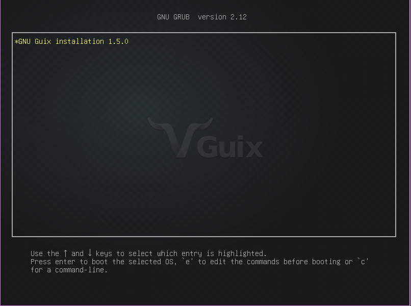
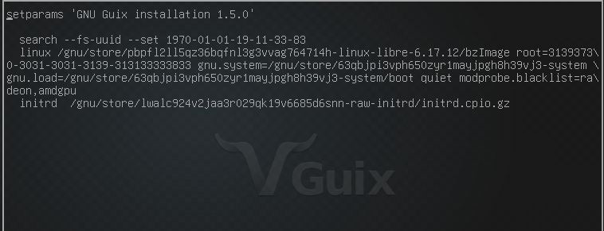
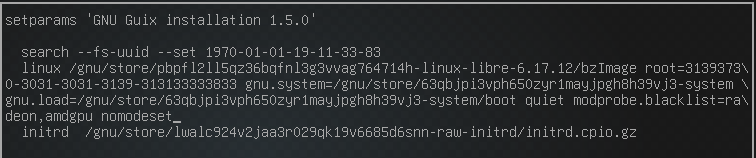

# guix-qubes

A [Guix](https://guix.gnu.org) channel that turns **Guix System** into a properly integrated [Qubes OS](https://www.qubes-os.org) qube. It packages the Qubes R4.3 guest agents and wires them into Guix System as one service, `qubes-guest-service-type`.

Status: a daily-driven StandaloneVM (HVM) on Qubes R4.3. Everything below has been verified unless it says otherwise.

| Feature                                                                                      | Status                                                  |
|----------------------------------------------------------------------------------------------|---------------------------------------------------------|
| qrexec (`qvm-run`, services, user switching via PAM)                                         | ✅                                                      |
| QubesDB                                                                                      | ✅                                                      |
| File copy (`qvm-copy` both ways, receive into `~/QubesIncoming`)                             | ✅                                                      |
| Seamless GUI (windows, clipboard, keyboard incl. full Apple layout, app menus, window icons) | ✅                                                      |
| Monitor layout changes                                                                       | ✅                                                      |
| Audio out and microphone (PulseAudio vchan sink/source)                                      | ✅                                                      |
| Networking from QubesDB (IP, gateway, DNS)                                                   | ✅                                                      |
| `qvm-shutdown` / `qvm-restart`                                                               | ✅                                                      |
| Memory balancing (meminfo-writer, memory hotplug)                                            | ✅                                                      |
| Feature advertisement (`qvm-features`, Services tab)                                         | ✅                                                      |
| U2F **and** FIDO2/passkeys via the CTAP proxy (sys-usb)                                      | ✅                                                      |
| split-gpg2 client (`gpg`, `git commit -S` with keys in a vault qube)                         | ✅                                                      |
| Block devices for dom0 (`qvm-block`, `qvm-start --cdrom=guix:/file.iso`)                     | 🚧 written, not yet tested                              |
| split-ssh client (`ssh`, `git` over SSH with keys in a vault qube)                           | ✅                                                      |
| TemplateVM / AppVM based on a Guix template                                                  | ✅                                                      |
| USB devices from sys-usb (`qvm-usb attach`, the devices widget)                              | ✅                                                      |
| PVH                                                                                          | ❌ not yet                                              |
| Qubes Update tool                                                                            | ❌ by design (use `guix pull` + reconfigure; see below) |

## What's in the channel

```
qubes/packages/vchan.scm        qubes-core-vchan-xen
qubes/packages/linux-utils.scm  qubes-linux-utils (meminfo-writer, qrexec libs) — R4.3 branch
qubes/packages/qrexec.scm       qubes-core-qrexec (agent, qrexec-client-vm, fork server)
qubes/packages/qubesdb.scm      qubes-core-qubesdb
qubes/packages/core-agent.scm   qubes-core-agent (qubes-rpc services, qfile-*), python-qubesagent
qubes/packages/gui.scm          qubes-gui-common, qubes-gui-agent (Xorg drivers, pulse module, session glue)
qubes/packages/ctap.scm         qubes-ctap (U2F/FIDO2 proxy, frontend)
qubes/packages/split-gpg.scm    qubes-split-gpg2-client
qubes/packages/split-ssh.scm    qubes-split-ssh-client
qubes/packages/usb-proxy.scm    qubes-usb-proxy (qubes.USBAttach: USB devices from sys-usb)
qubes/services/agent.scm        qubes-guest-service-type — the integration
qubes/system.scm                qubes-operating-system — adds all of it to any operating-system
qubes/installer.scm             qubes-installation-os — the qubes-guix installer ISO
iso/qubes-guix-iso              build that ISO (on any x86_64 Guix)
iso/qubes-guix-iso-remote       build it on another machine, from this checkout's HEAD
dom0/qubes-guix-create          dom0: create the qube and boot the installer
guest/qubes-guix-install        installer shell: unattended install (disk, config.scm, then finish-install)
guest/qubes-guix-finish-install installer, before the first reboot: config.scm + guix system init
guest/qubes-guix-setup          guest: channel, guix pull, config.scm, reconfigure
PORT-NOTES.md                   the porting log: every problem hit and why things are the way they are
```

The service runs everything under Shepherd. That covers QubesDB, the qrexec agent, the GUI agent, networking, feature advertisement, meminfo-writer and the CTAP proxy. It also provides:
- the block-device export: upstream's udev rule and scripts, so the qube's disks, USB drives and loop devices are listed by `qvm-block` in dom0, and `qvm-start --cdrom=QUBE:/path.iso` works with an ISO kept in a Guix qube;
- PAM stacks;
- `/etc/qubes-rpc`;
- the setuid `qfile-unpacker`;
- udev rules and kernel modules;
- the `qubes` group;
- the `/sbin/poweroff` and `/sbin/reboot` links that Xen's shutdown path calls.

## Using the channel

Add it to `~/.config/guix/channels.scm`:

```scheme
(cons* (channel
        (name 'qubes)
        (url "https://github.com/BetoHydroxyButyrate/qubes-guix")
        (branch "main")
        (introduction
         (make-channel-introduction
          "1101f87885074cb3ac8bddc314f274cfeba84e76"
          (openpgp-fingerprint            ; the signing SUBKEY (see .guix-authorizations)
           "9765 1FBD E504 F2D1 3DA9  88EB C0E8 4747 0C0B 2F22"))))
       %default-channels)
```

Then `guix pull`. Once the system is built with `qubes-operating-system` (below), you can skip this: the channel is also in the system-wide `/etc/guix/channels.scm`, which `guix pull` uses when you have no `~/.config/guix/channels.scm`. Commits are signed. Guix verifies them against `.guix-authorizations` and the key on the `keyring` branch.

## System configuration

The simplest way is to wrap your whole `operating-system` (the one the installer wrote, for example) in `qubes-operating-system`. `guest/qubes-guix-setup` does exactly this edit for you:

```scheme
(use-modules (gnu) (qubes system))

(qubes-operating-system
 (operating-system
   ;; ... unchanged ...
   ))
```

It adds what a qube needs and nothing else:
- **`%qubes-kernel-arguments`:** this is `xen_privcmd.unrestricted=1`. Without it, recent kernels refuse the hypercalls that vchan needs.
- **The `qubes` group for every regular user:** they need it for the Xen device nodes, `/var/run/qubes` and the CTAP hidraw device.
- **`qubes-guest-service-type`,** which provides `networking` itself, from QubesDB.
- **No NetworkManager, connman or DHCP client,** because they provide `networking` too, and Shepherd refuses two providers. A `static-networking` service for `eth0` has to go as well; the setup leaves `static-networking` alone, since `%base-services` uses it for loopback.

- **Passwordless `sudo` for the `qubes` group,** unless you pass `#:passwordless-sudo? #f`. This is the Qubes convention (upstream's `qubes-core-agent-passwordless-root`): the qube is the security boundary.
- **The qubes channel in `/etc/guix/channels.scm`** (Guix's default channels plus this one), unless you pass `#:system-channels? #f`. `guix pull` uses it for root and for every user without a `~/.config/guix/channels.scm`. `#:channel-branch "BRANCH"` records a branch other than `main`. If the `guix-service-type` configuration already lists channels, the qubes one is added to them, unless one named `qubes` is already there.
- **The system's own `guix` includes the qubes channel,** unless you pass `#:system-guix? #f`. It's built from the channels of the Guix doing the build (`guix-for-channels`), so `guix describe` lists qubes from the first boot, and `sudo guix system reconfigure` works before any user `guix pull`. Building it makes root fetch the channels. In a template without a netvm, reconfigure with `qubes-guix-update -r`, which passes the updates proxy through `sudo`; a plain `sudo guix system reconfigure` can't reach the channels there.
- **No graphical login (display manager),** unless you pass `#:display-manager? #t`. `%desktop-services` always includes GDM, whatever desktop you chose. In a qube, the Qubes GUI agent provides the windows, and GDM refuses a console login while the agent's session for that user is open ("Session Already Running"). The console becomes a text login, and your desktop's packages (XFCE etc.) stay installed. Services that extend the display manager, such as the installer's `set-xorg-configuration`, are removed with it.

To pass options, use `(qubes-operating-system os #:config (qubes-guest-configuration ...))`. It is idempotent: applying it to an `operating-system` that already has the service changes nothing more.

To write it out by hand instead:

```scheme
(use-modules (gnu) (qubes services agent))
(use-service-modules networking)

(operating-system
  ;; ...
  (kernel-arguments (append %qubes-kernel-arguments %default-kernel-arguments))
  (users (cons (user-account
                (name "user")
                (group "users")
                (supplementary-groups '("wheel" "audio" "video" "qubes")))
               %base-user-accounts))
  (services (cons (service qubes-guest-service-type)
                  (modify-services %desktop-services     ; or %base-services
                    (delete network-manager-service-type)))))
```

A local desktop (e.g. XFCE on `:0`) can coexist: the Qubes GUI agent runs its own X server on `:1`, with no VT.

### Options

```scheme
(service qubes-guest-service-type
         (qubes-guest-configuration
          (gui? #t)                    ; #f: headless (qrexec, qubesdb, file copy only)
          (network? #t)                ; configure the uplink from QubesDB
          (network-interface "eth0")
          (ctap-backend "sys-usb")     ; #f: no U2F/FIDO2 proxy
          (split-gpg2 qubes-split-gpg2-client)  ; #f: no split-gpg2 client
          (split-ssh qubes-split-ssh-client)    ; #f: no split-ssh client
          (usb-proxy qubes-usb-proxy)           ; #f: no USB devices from sys-usb
          (default-menu-items '("xfce4-terminal.desktop" "thunar.desktop"))
          (features-request? #t)))      ; #f: don't advertise features to
                                       ; dom0 (the installer ISO)
                                       ; what dom0 shows in the Qubes menu by
                                       ; default (only the installed ones)
```

Package fields (`qrexec`, `qubesdb`, `core-agent`, `gui-agent`, `ctap`) can be overridden too.

## The qubes-guix installer ISO

*New, not yet tested.* `iso/qubes-guix-iso` builds an installer ISO for Qubes (`qubes/installer.scm`). It's the Guix installer plus a headless Qubes agent: QubesDB, the qrexec agent, and the network from QubesDB. Under Qubes, that removes every manual step of the stock ISO:
- **No GRUB edit:** `nomodeset` is on its kernel command line.
- **No network setup:** the address, gateway and DNS come from QubesDB, as in any qube.
- **No typing into the console:** dom0 drives the install with `qvm-run -u root`, and the output shows in the dom0 terminal.
- **Nothing to build for the Qubes agents:** the ISO's `guix` already includes the qubes channel, and its store has the Qubes packages built by that Guix. `qubes-guix-finish-install` uses that Guix directly, instead of `guix time-machine`.

The guest scripts are on the ISO, in `/root/qubes-guix/guest`, and so is git. The installer's own dialogs (tty1) still work for a manual install.

Build it on an x86_64 Guix, such as a Guix qube or your substitute server:

```
qubes-guix/iso/qubes-guix-iso                     # qubes-guix-installer.iso, at the head of main
qubes-guix/iso/qubes-guix-iso --server https://guix-subs.example   # at the commits your server last built
qubes-guix/iso/qubes-guix-iso -b template --offline -o /tmp/qgi.iso
```

`--server URL` builds every channel at the commits the server last built (its `/channel-commits`, as [guix-subs](https://github.com/BetoHydroxyButyrate/guix-subs) publishes) and fetches from it first. Nearly everything then comes from your server, and so does the rest of an install, such as Xfce. The substitute servers come from a file like dom0's, `--substitutes FILE`, by default the checkout's `dom0/qubes-guix-substitutes`: all its `url`s are tried before the default servers (their keys must already be authorized on the build machine). Without `--server`, the file's first `url` is the server; `--no-server` builds at the branch head instead. An install locked to the same server (below) then uses the ISO's Guix as it is. The ISO also carries the substitutes file: its own guix-daemon uses those servers, and an install that gets no substitutes from dom0 uses the ISO's, records them in `config.scm`, and, unless told otherwise, locks to the ISO's own channel commits. So an ISO built from your server installs and updates from it with nothing extra in dom0. The server must be up to date: one that last built qubes-guix from before the ISO support can't build an ISO. `--guix-commit` and `--qubes-commit` pin those channels by hand. `--offline` also puts into the ISO everything the default unattended install needs, and the channels' git checkouts, so that install needs no network at all; the ISO grows by a few GiB. Next to the ISO, `FILE.channels` records the channels it was built from. `-L DIR` builds from a checkout with your current Guix, for testing; that ISO's guix lacks the qubes channel, so installs from it fall back to `guix time-machine`.

The qubes channel comes from its repository, never from a checkout: work you haven't committed and pushed isn't in the ISO, and with `--server` neither is anything newer than the server's last build. To build on a bigger machine (the substitute server) what you're working on elsewhere, run `iso/qubes-guix-iso-remote` in your working checkout. It stops on uncommitted changes in `qubes/`, `guest/` or `iso/` (untracked files too), force-pushes HEAD to a scratch branch (`iso`), waits for the channel's repository to have it (a mirror can lag), then on the build host (`--host`, default `guix-subs`; `--dir`, default the same path under your home) checks that commit out in its checkout and runs `iso/qubes-guix-iso -b iso --qubes-commit head`, plus whatever follows `--`. qubes is then exactly your HEAD, and the other channels are at the server's last build:

```
iso/qubes-guix-iso-remote                          # on guix-subs, from this HEAD
iso/qubes-guix-iso-remote -- --offline -o qgi-offline.iso
```

Then, in dom0, one command creates the qube and installs it:

```
./qubes-guix-create --unattended guix work:/home/user/qubes-guix-installer.iso     # add --template for a template
```

It asks for the password, creates the qube, and boots the ISO. dom0 waits for the installer's qrexec agent (the `qrexec` feature is set first). Then it runs `guest/qubes-guix-install` in it, detached, and follows the log; Ctrl+C stops following, not the install. When the install powers the qube off, it starts the qube from its disk, runs the first `qubes-guix-update -r`, and shuts a template down, as below. Without `-b`, the install uses the ISO's own scripts and its channel branch, which is what its prebuilt packages match. `-b BRANCH` clones that branch instead. The packages, channels and substitutes files work as for the stock ISO.

Without `--unattended`, it creates the qube, boots the ISO and prints the two ways on: `--unattended NAME`, or the installer's dialogs followed by `--finish-install NAME`. Over qrexec, `--finish-install` runs straight away and then restarts the qube from its disk, because a reboot inside the qube would boot the ISO again. The installer's network step may find no device to configure (connman is gone, since the agent provides `networking`): continue, the network is up.

dom0 recognises the ISO by a file name containing `qubes-guix`, or from `--unattended`. Otherwise pass `--qubes-iso` (or `--stock-iso`). It matters because dom0 waits up to `qrexec_timeout` for the agent of a qube with the `qrexec` feature, then kills it. The stock ISO has no agent.

The installer never sends its features to dom0 (`features-request? #f` in `qubes-guest-configuration`). dom0 keeps the first `qrexec` and `gui` values a qube gives, and the installer's `gui=0` would have stuck to the installed system.

## Creating the qube (dom0)

`dom0/qubes-guix-create` creates the qube and boots it from an installer ISO: the qubes-guix one (above), or the stock Guix System installer ISO, which this section is about. Download the ISO from [guix.gnu.org](https://guix.gnu.org/en/download/) into any qube, then copy the script into dom0. Read it first: anything you copy into dom0 runs with full control of the machine.

```
# dom0 — <qube> is where you cloned this repository
qvm-run --pass-io <qube> 'cat qubes-guix/dom0/qubes-guix-create' > qubes-guix-create
chmod +x qubes-guix-create
./qubes-guix-create guix untrusted:/home/user/Downloads/guix-system-install-1.5.0.x86_64-linux.iso
```

```
qubes-guix-create [options] NAME ISO_VM:ISO_PATH [VCPUS [MEMORY [MAXMEM]]]
  defaults: 2 vCPUs, 4000 MiB, MAXMEM = MEMORY (no balancing); -s root size (60g), -l label, -n netvm, --dry-run
```

It checks everything before changing anything, and removes the qube again if a step fails. It creates a StandaloneVM in HVM mode that boots its own kernel, grows the root volume, sets `skip-update` (the Qubes Update tool can't update Guix), raises `qrexec_timeout` to 300 s, and turns on memory balancing when MAXMEM > MEMORY. Then it boots the installer and prints the qube's network settings. Qubes networking is static, so you may need these in the installer and in your first `config.scm`. Until the agent runs, the qube has exactly MEMORY, which is why the default is 4000 MiB: `guix system init` needs it.

**Memory balancing makes every boot slower.** An HVM whose MAXMEM is above MEMORY boots in Xen's populate-on-demand mode, and a Guix boot then takes much longer to reach the qrexec agent. Measured: 24 s at 8000/8000, 83 s at 8000/32542. Past the default 60 s `qrexec_timeout`, `qvm-start` gives up and kills the qube, uncleanly. So the script leaves balancing off by default and sets the timeout to 300 s either way. If you want balancing, keep the gap between MEMORY and MAXMEM small. You can change it later in the qube's settings ("Include in memory balancing").

The installer needs three manual steps under Qubes, and the script prints them with this qube's values:
1. **In GRUB:** with **GNU Guix installation** highlighted, press `e`:

   

   This shows the boot commands. Move to the end of the `linux` line (it wraps; it ends with `modprobe.blacklist=radeon,amdgpu`):

   

   Add ` nomodeset` there, then press Ctrl+X to boot:

   

   Without `nomodeset`, the console on VT3 doesn't work. Only the installer needs it: the installed system boots fine without it.
2. **Network:** Qubes has no DHCP, so the network is set by hand, in the root shell on VT3. In dom0, `./qubes-guix-create --type-network guix` does it: click the qube's console window, and it switches to VT3 (Ctrl+Alt+F3) and types the commands with this qube's address, gateway and DNS. By hand it's `ip addr add <ip>/8 dev eth0`, `ip link set eth0 up`, `ip route add default via <gateway>` and the DNS servers in `/etc/resolv.conf`. The **/8** puts the gateway on-link.
3. **Back to the installer:** dom0's desktop grabs Alt+Fn, so switch consoles from dom0 with `xdotool key --window $(xdotool selectwindow) ctrl+alt+F1` and click the qube's window.

Then install as usual, up to the **Installation complete** screen, and **don't reboot yet**: the next section makes the new system a qube before its first boot.

### Unattended install (instead of the installer's dialogs)

*New, not yet tested.* After the GRUB step, at the installer's first screen, run in dom0:

```
./qubes-guix-create --unattended guix          # add --template for a template, -b BRANCH to test a branch
```

It asks for one password, used for both `user` and root. Only a hash of it is typed into the qube. With `--no-password`, both accounts are left as after a manual Guix install; `qvm-run` works either way. Then click the qube's console window. On VT3 it types:
- the network setup;
- a clone of this repository;
- the command to run `guest/qubes-guix-install`.

**Extra packages:** list them in `dom0/qubes-guix-packages`, one or more per line, with `#` for comments. Copy it into dom0 next to `qubes-guix-create` and edit it, or pass another file with `--packages FILE`. Without one you get `git`. They go into the qube's `config.scm` as `#:extra-packages '("git" …)` in the `(qubes-operating-system …)` form. A name Guix doesn't have is skipped with a warning, never an error, both at install time and at every later reconfigure. To change the set, edit that list in `/etc/config.scm`, then run `qubes-guix-update -r`. `--finish-install` and `--bootstrap` read the same file.

**Extra channels:** put `(channel …)` forms in `dom0/qubes-guix-channels`, copied into dom0 (the current directory, or next to `qubes-guix-create`), or pass a file with `--channels FILE`. The template file has everything commented out. They go into `config.scm` as `#:extra-channels`, so pulls and the system's own `guix` include them. `--unattended` and `--finish-install` also build with them, so the packages file can name their packages, for example `firefox-esr` from nonguix. Take each channel's introduction from its own documentation. A channel with its own substitute server also needs `#:extra-substitute-urls` and `#:extra-authorized-keys` in `config.scm`; otherwise its packages build from source. To add a channel to an existing qube, add it to `#:extra-channels` in `/etc/config.scm` and run `qubes-guix-update -r` twice. The first run records the channel in `/etc/guix/channels.scm`. The second pulls it and builds its packages.

**Your own substitute server:** put `url` and `key` lines in `dom0/qubes-guix-substitutes`, copied into dom0 (the current directory, or next to `qubes-guix-create`), or pass a file with `--substitutes FILE`. The template file has everything commented out. A server can be your own `guix publish`, or a cache of bordeaux and ci. The install tries these servers before the default ones, with its keys authorized in the installer. They also go into `config.scm` as `#:extra-substitute-urls` and `#:extra-authorized-keys`, so updates use them too. With a server, `--unattended` locks the qube to it (`--guix-commit server`) unless you say otherwise: `--guix-commit C` for a Guix commit, or `--guix-commit head` to follow the head. `--guix-commit server` needs a server that publishes its commits ([guix-subs](https://github.com/BetoHydroxyButyrate/guix-subs) does): every channel the qube shares with the server, qubes and nonguix included, is then locked at the server's commit (`/channel-commits`, recorded as `#:channel-commits`), so nearly everything comes from your server. A server that publishes only `/guix-commit` locks Guix alone. Later, `qubes-guix-update --guix-commit server` moves the qube to the server's latest build. The installer's netvm must reach the server, and so must a template's UpdateVM.

A TemplateVM is detected even without `--template`. It gets `updates-proxy-setup` when it's created, and loses its netvm after the install. From then on, it updates through the Qubes updates proxy like other templates. `qubes-guix-update` handles `guix pull`, and guix-daemon handles substitutes.

That script:
1. **Disk:** partitions `/dev/xvda` as GPT, with a 1 MiB BIOS boot partition and an ext4 root labelled `guix-root`. It refuses a disk that already has partitions unless you pass `--force`.
2. **Configuration:** writes `/etc/config.scm` with Xfce, `%desktop-services`, the user `user`, dom0's timezone, and the qube's name as host name.
3. **Build:** runs `qubes-guix-finish-install`.
4. **Power off:** sets the passwords and powers off.

`qubes-guix-create` waits for the qube to stop, then starts it from its disk. Use `--no-wait` to skip that. The only manual steps left are the GRUB edit, the password and one click.

## Setting up the guest

### Before the first reboot (recommended)

At the installer's **Installation complete** screen, with the installer's network still up from `--type-network`, run in dom0:

```
./qubes-guix-create --finish-install --run guix   # add --template for a template, -b BRANCH to test a branch
```

Click the qube's console window when asked. On VT3 this clones the repository into `/root/qubes-guix` (git comes from `guix shell`) and runs `guest/qubes-guix-finish-install` as root. That script wraps `/mnt/etc/config.scm` in `(qubes-operating-system ...)` (the original stays as `config.scm.pre-qubes`), checks it, and rebuilds `/mnt` with `guix system init` from a Guix that includes the qubes channel (`guix time-machine`). If the installer has already unmounted the new system, the script mounts it again; that works for a single unencrypted root partition. The first run builds a Guix and then the Qubes agents, so it takes a while, but nothing waits for a password. Without `--run` it only clones and shows the command, for you to review and type.

When VT3 says **Done**, reboot. That's the last manual step. The first boot has:
- the network from QubesDB;
- qrexec and the GUI agent;
- passwordless `sudo` for the `qubes` group;
- the qubes channel in `/etc/guix/channels.scm`.

Run `guix pull` before your first `sudo guix system reconfigure /etc/config.scm`.

### After the first boot

If you've already rebooted into the plain installed system, log in as root on its console (VT3) and run this in dom0:

```
./qubes-guix-create --bootstrap guix            # add --template for a template, -b BRANCH to test a branch
```

This types a short script into `/tmp/qubes-guix-bootstrap.sh` on the qube and shows it there, without running it. Read it, then run `sh /tmp/qubes-guix-bootstrap.sh`. The script sets the network, then runs `qubes-guix-setup` as the uid-1000 user.

`sudo` asks for that user's password **at the start**, before the long `guix pull`. A background loop then keeps sudo's timestamp fresh until the script ends. So you can walk away, and the `sudo` steps an hour later won't time out waiting for a password. From then on, passwordless sudo is part of the system.

Or by hand, as your normal user in the new system:

```
guix shell git -- git clone https://github.com/BetoHydroxyButyrate/qubes-guix
qubes-guix/guest/qubes-guix-setup
sudo reboot
```

`qubes-guix-setup`:
1. adds the qubes channel to `~/.config/guix/channels.scm` and runs `guix pull`;
2. wraps `/etc/config.scm` in `(qubes-operating-system ...)` and saves the old one as `/etc/config.scm.pre-qubes`;
3. checks the new configuration with a dry-run build before installing it, then runs `guix system reconfigure`. That builds the Qubes agents from source, so it takes a while.

If any step fails it stops, and `/etc/config.scm` is left as it was. Running it again is safe, since steps already done are skipped.

After the reboot the network comes from QubesDB, and dom0 hides the emulated VGA window once the Qubes GUI agent connects. If you need the console back, run `qvm-start-daemon --force-stubdomain guix`. Check from dom0:

```
qvm-run --pass-io guix 'ip -br addr'
qvm-features guix          # qrexec, gui, os-distribution=guix, ...
qvm-run guix alacritty     # or anything installed
```

## A Guix template and its AppVMs

*Partly tested:* on guix-tmpl, the private volume, `/home` on `/rw/home`, swap, passwordless sudo, and substitutes through the updates proxy with no netvm all work. AppVMs are not tested yet. A template works like a Debian or Fedora one:
- **Root is the template's.** An AppVM's root (with `/gnu/store` and `/var/guix`) is a fresh copy of the template's at every start. `guix install` in an AppVM lasts until shutdown, like `apt install`. Software that should stay goes in the template's `config.scm`. A manifest kept in your home (`guix shell -m manifest.scm`) survives, because home is on the private volume; its packages come back from substitutes.
- **`/home` is per qube,** on the private volume (`/rw/home`). On a qube's first start it's seeded from the template's `/home`.

Create it with `--template`, then set it up with `--template`:

```
./qubes-guix-create --template guix-tmpl untrusted:/path/to/guix-system-install.iso   # dom0
./qubes-guix-create --finish-install --template --run guix-tmpl                        # dom0, at "Installation complete"
qubes-guix/guest/qubes-guix-setup --template                                           # or: in the template, after its first boot
```

Install with a single root partition: no separate `/home`, because the template mounts its own `/home`. `qubes-guix-setup --template` also prints the dom0 steps that follow. After a `sudo shutdown` and one test start:

```
qvm-create --template guix-tmpl --label red \
    --property virt_mode=hvm --property kernel='' \
    --property memory=4000 --property maxmem=4000 work
```

An AppVM needs more than Qubes gives one by default: `virt_mode hvm` (the default is PVH), its kernel from the template's disk (`kernel ''`), more than the default 400 MiB, a longer `qrexec_timeout`, and, for memory balancing, `maxmem` above `memory` and the `meminfo-writer` service. `qubes-guix-create --appvm` sets all of that, its Qubes menu (the template's `default-menu-items`: the usual applications the template has, see Options), and with `--split-ssh` / `--split-gpg` / `--ctap` the vault clients' tag and services and the U2F/CTAP proxy (the same options work when installing a template or StandaloneVM, for that qube):

```
qubes-guix-create --appvm guix-tmpl -n sys-firewall work            # 2000 MiB, balancing up to 6000
qubes-guix-create --appvm guix-tmpl --test work 4000 8000           # then test it with qubes-guix-test
qubes-guix-create --appvm guix-tmpl --split-ssh --split-gpg --ctap --test work
```

By hand, memory balancing is `qvm-prefs NAME maxmem MiB` (above `memory`), and nothing else: Qubes runs the `meminfo-writer` service by `maxmem`, and setting that service (`qvm-service NAME meminfo-writer on`) resets `maxmem` to 0, unticking "Include in memory balancing".

Keep the template's netvm until the updates proxy works. dom0 normally enables `updates-proxy-setup` for templates; if not, run `qvm-service guix-tmpl updates-proxy-setup on`. Start the template and check `herd status qubes-updates-proxy` in it. guix-daemon should then have the proxy in its environment: `sudo cat /proc/$(pgrep -o guix-daemon)/environ | tr '\0' '\n' | grep proxy`. Only then, if you want the template offline, run `qvm-prefs guix-tmpl netvm ''`. Substitutes then come through the proxy. `guix pull` fetches git in your own process, not through the daemon, so offline it needs `http_proxy` and `https_proxy` set to `http://127.0.0.1:8082` (tested: libgit2 honours them). `qubes-guix-update` does that for you (see Updating), and so does `pguix`: `pguix pull`, `pguix time-machine …` and so on run `guix` with the proxy set whenever the qube has `updates-proxy-setup`, and run plain `guix` otherwise. Commands that go through guix-daemon, such as `guix install`, `guix shell` and `guix build`, need nothing: the daemon already uses the proxy.

`#:template? #t` (in `qubes-operating-system`, or the `template?` field of `qubes-guest-configuration`) adds:
- `qubes-rwdev`: formats a blank private volume, seeds `/rw/home`, then `/rw` and the `/home` bind mount before `user-homes` runs;
- `qubes-volatile-swap`: 1 GiB of swap on the volatile volume, made at every boot;
- `qubes-hostname`: the host name from the qube's name, since AppVMs share the template's `config.scm`;
- `qubes-updates-proxy`: when dom0 enables `updates-proxy-setup` (templates), `127.0.0.1:8082` is forwarded over `qubes.UpdatesProxy` and guix-daemon uses it for substitutes. AppVMs keep their direct network. For `guix pull` without a netvm, set `http_proxy` and `https_proxy` to `http://127.0.0.1:8082`.

## Feature setup

### U2F / FIDO2 (CTAP proxy)

- **sys-usb:** its template needs the `qubes-ctap` package. Stock Fedora and Debian templates usually have it.
- **dom0:** run `qvm-service guix qubes-ctap-proxy on` and enable guix in **Qubes Global Config → USB Devices → U2F Proxy**. Global Config only allows the U2F (`u2f.*`) calls. For FIDO2 (passkeys, PINs), also add to `/etc/qubes/policy.d/30-user.policy`:
  ```
  ctap.GetInfo    *  guix  sys-usb  allow
  ctap.ClientPin  *  guix  sys-usb  allow
  ```
- **guix:** reboot after the first install. A reconfigure doesn't make the running udev reload its rules, so the virtual key's hidraw node would keep the wrong group.

### split-gpg2

- **Vault qube** (e.g. `gpg-admin`): install `split-gpg2` in its template. It coexists with split-gpg v1. The key needs **signing subkeys**: by default split-gpg2 exposes subkeys only, never the primary key.
- **dom0:**
  ```
  # /etc/qubes/policy.d/30-user.policy
  qubes.Gpg2  *  guix  @default  allow target=gpg-admin
  ```
  ```
  qvm-service guix split-gpg2-client on
  ```
- **guix:**
  ```
  # never start an empty local gpg-agent (keyboxd must still autostart, so not `no-autostart`)
  echo 'agent-program /run/current-system/profile/libexec/split-gpg2/gpg-agent-placeholder' >> ~/.gnupg/gpg.conf
  gpg --import pubkey.asc                    # the PUBLIC key (qvm-copy it from the vault)
  gpg -K                                     # sec# + ssb lines = working
  ```
  A warning that the agent "is older than us" is harmless. It just means the vault's GnuPG is older than Guix's.

### Split SSH

The SSH keys stay in a vault qube; Guix qubes use them through its `ssh-agent`, over qrexec (`qubes.SshAgent`). Every Guix qube with the GUI has the client: its session's `SSH_AUTH_SOCK` is `~/.ssh/qubes-agent.sock`, forwarded to whichever vault dom0's policy names. So enrolling a qube is only a policy line.

- **Vault qube** (e.g. `ssh-vault`, no netvm): its agent on a fixed socket, with the keys added; `-c` asks for confirmation at each use. For example, in its `~/.bashrc`, so opening a terminal there once after boot starts the agent and adds the key (or put it in an autostart entry):
  ```sh
  export SSH_AUTH_SOCK=$HOME/.ssh/agent.sock
  ssh-add -l >/dev/null 2>&1; [ $? -eq 2 ] && { rm -f "$SSH_AUTH_SOCK"; ssh-agent -a "$SSH_AUTH_SOCK" >/dev/null; }
  ssh-add -l >/dev/null 2>&1 || ssh-add -c ~/.ssh/id_ed25519
  ```
  And the service, in the vault's template (or `/usr/local/etc/qubes-rpc/` in the vault itself):
  ```sh
  # /etc/qubes-rpc/qubes.SshAgent
  #!/bin/sh
  notify-send "SSH agent used by $QREXEC_REMOTE_DOMAIN" 2>/dev/null
  exec socat - "UNIX-CONNECT:$HOME/.ssh/agent.sock"
  ```
  (`chmod +x`; `socat` must be installed.)
- **dom0:** which qubes may use it. Tag the Guix AppVMs (`qvm-tags NAME add split-ssh`), or allow any qube and answer each prompt:
  ```
  # /etc/qubes/policy.d/30-user-split-ssh.policy
  qubes.SshAgent  *  @tag:split-ssh  @default  allow target=ssh-vault
  qubes.SshAgent  *  @anyvm          @default  ask default_target=ssh-vault
  ```
- **Guix qube:** nothing. `ssh-add -l` lists the vault's keys (after a prompt, with `ask`). If the session already has `SSH_AUTH_SOCK` (another agent), that one is used instead.

### USB devices (qvm-usb)

A USB device in sys-usb can be attached to a Guix qube as to any other: the devices widget, or in dom0 `qvm-usb attach QUBE sys-usb:BUSID` (`qvm-usb` lists them). The device then appears in the qube as a local USB device. It goes over qrexec (`qubes.USBAttach` here, `qubes.USB` in sys-usb) into the kernel's USB/IP virtual host controller, `vhci-hcd`, which is loaded on the first attach.

- **dom0, sys-usb:** nothing beyond the usual Qubes USB setup. Each attach allows itself in dom0's policy for that one call.
- **Guix qube:** nothing; `qubes-usb-proxy` is in every qube (`(usb-proxy #f)` leaves it out). The kernel must have `vhci-hcd`: `qubes-guix-test` checks it.
- **Detach:** the widget, or `qvm-usb detach QUBE sys-usb:BUSID`.

Only the qube side is packaged: a Guix qube can receive USB devices, not be the USB backend (sys-usb).

Tested with a YubiKey's smart card (PIV, `yubico-piv-tool -a status`). Smart cards need `pcscd`, which isn't part of qubes-guix, and Guix's pcsc-lite asks polkit whether a user may use the reader. polkit doesn't know pcsc-lite's actions unless they're registered, so every client is refused, root included ("Action org.debian.pcsc-lite.access_pcsc is not registered"). In `config.scm`:

```scheme
(use-service-modules dbus security-token)
(use-package-modules security-token)       ; pcsc-lite

(define pcsc-polkit-rule                   ; members of "users" may use readers and cards
  (file-union "pcsc-polkit-rule"
    `(("share/polkit-1/rules.d/50-pcsc.rules"
       ,(plain-file "50-pcsc.rules" "\
polkit.addRule(function(action, subject) {
  if ((action.id == \"org.debian.pcsc-lite.access_pcsc\" ||
       action.id == \"org.debian.pcsc-lite.access_card\") &&
      subject.isInGroup(\"users\")) {
    return polkit.Result.YES;
  }
});
")))))

;; in (services ...):
(service pcscd-service-type)
(simple-service 'pcsc-polkit polkit-service-type
                (list pcsc-lite pcsc-polkit-rule))
```

After the reconfigure, polkit (started on demand by D-Bus, not a Shepherd service) must reread its actions: reboot, or `sudo pkill polkitd; sudo herd restart pcscd`. While a key is attached to a qube, sys-usb doesn't have it: U2F/FIDO2 through the CTAP proxy needs it detached again.

## Testing a qube

`dom0/qubes-guix-test` (copy it to dom0 next to `qubes-guix-create`) smoke-tests a Guix qube's Qubes integration and prints PASS, FAIL or SKIP for each check; its exit status is the number of failures. Given a template, it makes a throwaway AppVM from it (`test-guix-<pid>`, `--keep` to keep it), tests that, and removes it. Any other Guix qube is tested in place. It only touches the qube under test, so it's safe on a daily-use dom0.

```
qubes-guix-test guix-tmpl                         # template: via a throwaway AppVM
qubes-guix-test --split-gpg --split-ssh guix-tmpl # also the vault clients
qubes-guix-create --unattended --template --test …   # the same, after an install
```

It checks: start and boot time; qrexec; QubesDB; the features the agent requested; failed Shepherd services; network (address, gateway, DNS and HTTPS); the network coming back after the netvm is detached and reattached (as when the netvm restarts); 1 MiB through qrexec each way, checksummed; `qvm-copy-to-vm` (`qubes.Filecopy`); the trusted-channels link; memory balancing (meminfo in xenstore); the USB proxy (`qubes.USBAttach` and the `vhci-hcd` module present: no device is attached); a terminal window appearing in dom0; split-gpg2 and split-ssh (optional); and a clean shutdown.

Qubes' own integration tests (`qubes.tests.integ` in dom0, `QUBES_TEST_TEMPLATES=…`) can also run against a Guix template, but they stop qubesd and create and remove qubes: run them only on a machine set aside for testing. Their distribution-specific parts (updates) don't apply to Guix.

## Updating

There are two cases:
- **Updating the system:** run `qubes-guix-update -r`. It runs as root, through `sudo` if you aren't. It does root's `guix pull`, then `guix system reconfigure /etc/config.scm` with the Guix it just pulled. In a template with `updates-proxy-setup`, both go through the Qubes updates proxy, so the template needs no netvm. Without `-r` it only pulls. Other arguments go to `guix pull`, and `QUBES_GUIX_CONFIG` names another config file. `--guix-commit C` and `--head` move the Guix lock (below). Root does the update, as in other Qubes templates. Its pulled Guix and its checkout, in `/root`, are the only ones, and the reconfigure builds the system's `guix` from them. Users don't need to pull: their `guix` is the system's, at the level the template was updated to. A user's own `guix pull` (`~/.config/guix/current`) would override that for them, and `qubes-guix-update` points it out. Remove the link to go back to the system's.
- **Working on the channel itself:** use `sudo guix system reconfigure -L /path/to/checkout /etc/config.scm`. `-L` puts the checkout ahead of the pulled channel, so you can test before committing.

### Following the head, or locking Guix at a commit

There are no substitutes for this channel's packages, so they're built from source on your machine. They are built against whatever Guix provides (gcc, glibc, python, Xorg…). Each pull that moves the Guix channel changes those inputs, and the next reconfigure rebuilds every Qubes package, which takes a long time.

So a qube, typically a template, does one of two things:
- **Follows the head** (the default): every `qubes-guix-update -r` pulls current Guix master and rebuilds. You get fixes as they land, and occasionally breakage.
- **Is locked at a commit:** `#:guix-commit "C"` on its `qubes-operating-system` form pins Guix at C in `/etc/guix/channels.scm`. Every `guix pull` and `qubes-guix-update` stays there, so reconfigures only rebuild when this channel changes. Choosing C, and testing it, is up to whoever builds the template. A commit you've already run, from `guix describe`, is a good start.
- **Is locked to a substitute server:** `#:channel-commits '((guix . "C1") (qubes . "C2") …)` pins each channel it names, the way `#:guix-commit` pins Guix. `qubes-guix-update --guix-commit server` writes it from the server's `/channel-commits`. Then the Qubes packages, and those of other channels, are the server's builds too, not built here. (`#:guix-commit`, if set, wins for Guix.)

Moving between them:

```
qubes-guix-update --guix-commit C   # lock at C (or move the lock): edits config.scm, pulls C, reconfigures
qubes-guix-update --guix-commit server  # lock every channel at your server's last build
qubes-guix-update --head            # unlock: every channel back to following the head
```

**Working on a channel while locked:** `#:follow-head '(qubes)` makes the channels it names follow their branch even though `#:channel-commits` pins them (`#t`: all of them). Set it and run `qubes-guix-update -r`: that pull and the reconfigure already use the head. The lock stays recorded; remove the name, and the next `qubes-guix-update -r` goes back to it.

`qubes-guix-create --unattended --guix-commit C` records the lock at install time. The install itself always builds with the installer's own Guix, which is fast because nearly everything comes from substitutes. Then `--unattended` starts the qube and runs `qubes-guix-update -r` once, which takes it to the head or to C. A template is then shut down, ready. `--no-update` skips that step.

With `#:guix-commit` alone, the qubes channel isn't locked: it follows its branch. For a one-off build at another commit, without moving the lock, there's `guix time-machine --commit=C -- …`.

**AppVMs follow their template, with nothing to configure.** An AppVM's root, including `/gnu/store` and `/var/guix`, comes from the template at every boot, and its `guix` is the template's system Guix. Its home is its own: on first start it's made fresh, from the skeleton files, not copied from the template's `/home`, as in upstream Qubes. So a template's caches and dotfiles stay in the template. An updated template means an updated Guix in the AppVM at its next boot. `guix pull` in an AppVM gives a newer one until shutdown, like `apt` in a Debian AppVM. Its first pull is slow, because it builds its own `~/.cache/guix` from scratch.

### Firefox ESR (nonguix)

GNU IceCat is the browser Guix ships. If you'd rather have Firefox ESR, it's in the [nonguix](https://gitlab.com/nonguix/nonguix) channel, which carries non-free software. Add it next to the qubes channel in `~/.config/guix/channels.scm`. Take the `introduction` from the nonguix README rather than from here, so you check it at its source:

```scheme
(channel
 (name 'nonguix)
 (url "https://gitlab.com/nonguix/nonguix")
 (introduction
  (make-channel-introduction
   "897c1a470da759236cc11798f4e0a5f7d4d59fbc"
   (openpgp-fingerprint
    "2A39 3FFF 68F4 EF7A 3D29  12AF 6F51 20A0 22FB B2D5"))))
```

- **Use its substitute server.** Building Firefox yourself takes hours. The nonguix README explains how to authorize it: in `config.scm`, modify `guix-service-type` to add the server to `substitute-urls` and its key to `authorized-keys`.
- **Install it system-wide**, in `config.scm`'s `packages` field with `(use-modules (nongnu packages mozilla))`. Then its `.desktop` file is in the system profile, where `qubes.GetAppmenus` finds it. After reconfiguring, run `qvm-appmenus --update guix` in dom0 and Firefox ESR appears in the qube's menu.
- **If you pin Guix, pin nonguix too.** nonguix follows current Guix, so an old Guix commit with the newest nonguix may not build. Move the two pins together.

## Upstream bugs found (patched here)

Each fix is a build phase in the relevant package, with a comment, and each bug is reported upstream. The phases go once the fixes reach a release this channel builds.

- **qrexec-agent:** `env_buf[64]`. **qubes-gui-runuser:** `env_buf[256]`. Both abort the PAM session when `SHELL` or `PATH` is long; store paths are. ([QubesOS/qubes-issues#11163](https://github.com/QubesOS/qubes-issues/issues/11163))
- **qubes-app-u2f:** replies to CTAPHID_CBOR requests are framed as CTAPHID_MSG, which breaks spec-compliant FIDO2 clients. ([QubesOS/qubes-issues#10981](https://github.com/QubesOS/qubes-issues/issues/10981))
- **qubes-app-u2f:** a makeCredential request without `rp.name` is rejected, although CTAP2 allows that. ([QubesOS/qubes-issues#11162](https://github.com/QubesOS/qubes-issues/issues/11162))

## Gotchas worth knowing

- **Build the Qubes components from the branch matching dom0's release, not `main`.** Upstream supports a newer dom0 with older qubes, not the reverse. For example, qubes-linux-utils from `main` reports swapinfo, which only an R4.4 dom0 accepts, and on R4.3 its meminfo-writer exits after one update ([QubesOS/qubes-issues#11164](https://github.com/QubesOS/qubes-issues/issues/11164), closed as an unsupported combination). This channel builds the R4.3 branches.
- **`/var/run` is not `/run` on Guix, and `/var/run` survives reboots.** Stale pidfiles bite.
- **There is no `/sbin`.** The service creates the two links Xen's shutdown path needs.
- **Services in packages other than core-agent are linked into `/run/qubes-rpc`.** The qrexec agent searches there first.
- **Packages can add their own session start-up hooks.** `qubes-session` runs every executable in `/run/current-system/profile/lib/qubes/session.d/` (the split-gpg2 client uses this). This replaces XDG autostart.

See `PORT-NOTES.md` for the full story.

## License

The packaged software is GPL-2.0-or-later (Qubes OS upstream). Channel code: TODO — see `COPYING`.
