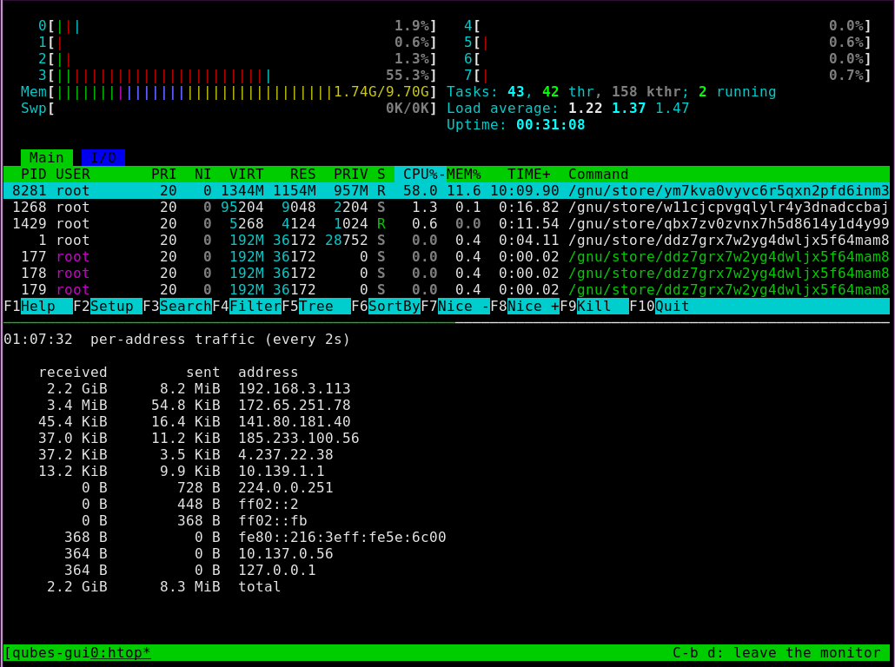

# qubes-guix

A [Guix](https://guix.gnu.org) channel that turns **Guix System** into a properly integrated [Qubes OS](https://www.qubes-os.org) qube. It packages the Qubes R4.3 guest agents and wires them into Guix System as one service, `qubes-guest-service-type`. dom0 scripts create the qube and install it, unattended.

Status: release candidate, [v0.1.0-rc1](NEWS.md). Daily-driven on Qubes R4.3, as StandaloneVMs, templates and AppVMs (AppVMs have seen less use so far). PVH, the new default for installs, has been tested on AppVMs. Everything below has been verified unless it says otherwise.

| Feature                                                                                      | Status                                                  |
|----------------------------------------------------------------------------------------------|---------------------------------------------------------|
| qrexec (`qvm-run`, services, user switching via PAM)                                         | ✅                                                      |
| QubesDB                                                                                      | ✅                                                      |
| File copy (`qvm-copy` both ways, receive into `~/QubesIncoming`)                             | ✅                                                      |
| Seamless GUI (windows, clipboard, keyboard incl. full Apple layout, app menus, window icons) | ✅                                                      |
| Monitor layout changes                                                                       | ✅                                                      |
| Audio out and microphone (PulseAudio vchan sink/source)                                      | ✅                                                      |
| Networking from QubesDB (IP, gateway, DNS)                                                   | ✅                                                      |
| `qvm-shutdown` / `qvm-restart`                                                               | ✅                                                      |
| Memory balancing (meminfo-writer, memory hotplug)                                            | ✅                                                      |
| Feature advertisement (`qvm-features`, Services tab)                                         | ✅                                                      |
| U2F **and** FIDO2/passkeys via the CTAP proxy (sys-usb)                                      | ✅                                                      |
| split-gpg2 client (`gpg`, `git commit -S` with keys in a vault qube)                         | ✅                                                      |
| Block devices for dom0 (`qvm-block`, `qvm-start --cdrom=guix:/file.iso`)                     | ✅ (booting a qube from an ISO in a Guix qube: tested by CI) |
| split-ssh client (`ssh`, `git` over SSH with keys in a vault qube)                           | ✅                                                      |
| TemplateVM / AppVM based on a Guix template                                                  | ✅ (AppVMs: little use so far)                          |
| USB devices from sys-usb (`qvm-usb attach`, the devices widget)                              | ✅                                                      |
| PVH (no QEMU, no stub domain; the default for new installs, `--hvm` to opt out)              | ✅ new                                                  |
| Qubes Update tool                                                                            | ❌ by design (`qubes-guix-update`: see [Updating](doc/updating.md)) |

## Getting started

There are three ways in. Each ends with the same kind of qube; they differ in what you build first, and in how much each install builds and downloads.

|                        | [Stock Guix ISO](doc/install-stock-iso.md) | [qubes-guix ISO](doc/install-qubes-iso.md) | [Full setup](doc/full-setup.md)                  |
|------------------------|--------------------------------------------|--------------------------------------------|--------------------------------------------------|
| Build first            | nothing                                    | the installer ISO, on any x86_64 Guix      | a [guix-subs](https://github.com/BetoHydroxyButyrate/guix-subs) server, and the ISO from it |
| By hand in the install | a GRUB edit, and a click                   | nothing                                    | nothing                                          |
| Qubes agents           | built from source, in every new qube       | prebuilt, in the ISO                       | prebuilt, on your server                         |
| Downloads from         | Guix's substitute servers                  | Guix's substitute servers                  | your server, nearly all                          |
| Suits                  | trying it out                              | a few qubes                                | many qubes, templates kept in step               |

- **[Stock Guix ISO](doc/install-stock-iso.md):** Guix's own installer ISO, and the dom0 scripts copied in (`qubes-guix-refresh`). The quickest start, and the slowest install.
- **[qubes-guix ISO](doc/install-qubes-iso.md):** build the installer ISO once; then one dom0 command installs a qube from it, with no manual steps.
- **[Full setup](doc/full-setup.md):** your own substitute server builds every channel at one set of commits; the ISO and every qube installed from it use those builds. An install then comes almost entirely from your LAN:

*The installer's monitor (its console, tty1) during an automatic install from the ISO, `qubes-guix-create --unattended`: htop above, the traffic per remote address below. The ISO was built from guix-subs (`--server`): 2.2 GiB came from it, over the LAN, and a few MiB from anywhere else.*

## Software in AppVMs

An AppVM's root, `/gnu/store` included, is its template's again at every start: `guix install` there lasts until shutdown. What most AppVMs need goes in the template. What one AppVM needs goes in `~/.config/guix/manifest.scm` (or a Guix Home, `~/.config/guix/home.scm`), which `qubes-guix-profile` puts back at each login, from your substitute server when it has the packages. See [Software in AppVMs](doc/templates.md#software-in-appvms).

## Documentation

- [Configuring the system](doc/configuration.md): the channel, `qubes-operating-system` and its options, extra packages and channels.
- [Templates and AppVMs](doc/templates.md): a Guix template, and AppVMs based on it.
- [Features](doc/features.md): U2F/FIDO2, split-gpg2, split-ssh, USB devices.
- [Updating](doc/updating.md): `qubes-guix-update`, following the head or locking to commits, Firefox ESR from nonguix.
- [Testing a qube](doc/testing.md): `qubes-guix-test`.
- [Internals](doc/internals.md): what's in the channel, the upstream bugs patched here, and gotchas. [PORT-NOTES.md](PORT-NOTES.md) is the full porting log.
- [Release notes](NEWS.md).
- [CI](ci/README.md): installs and tests on a bare-metal Qubes machine at every push.

## License

The channel's own code (Scheme, scripts, documentation) is GPL-3.0-or-later, like Guix: see [COPYING](COPYING). The Qubes OS software it packages keeps its upstream licence, mostly GPL-2.0-or-later (each package's `license` field says).
